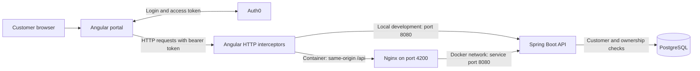
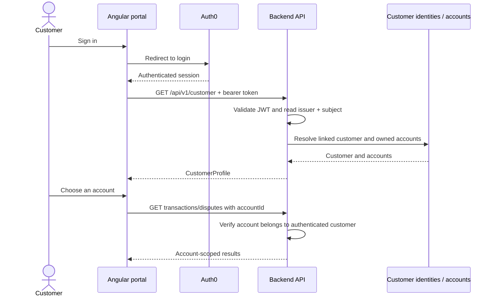
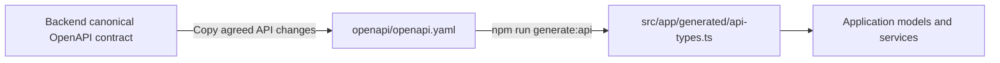

# Card Dispute Portal


Choose an account. View transactions. Submit a dispute and track its progress.

[🚀 Start](#quick-start) · [🏗️ Architecture](#architecture) · [🔐 Customer identity](#customer-identity) · [📜 API contract](#api-contract) · [⚙️ More options](#run-options) · [🛠️ Troubleshooting](#troubleshooting)

## Prerequisites

| Run mode | You need |
| --- | --- |
| 🐳 Containers | Docker Desktop / Docker Engine + Compose, or Podman + Compose provider; engine running |
| 🟢 Local frontend | Node.js 22 and npm; backend running separately |
| 🔐 Login | Internet access for Auth0 and a login linked to a backend customer |

The backend lives in the separate `card-dispute-service` repository. Clone both projects. Container builds install frontend dependencies automatically; local development uses `npm ci`.

| Address | Purpose |
| --- | --- |
| [localhost:4200](http://localhost:4200) | Portal |
| [localhost:8080/actuator/health](http://localhost:8080/actuator/health) | Backend health |
| [localhost:8080/swagger-ui.html](http://localhost:8080/swagger-ui.html) | Backend API explorer |
| `localhost:5432` | PostgreSQL exposed by backend Compose |

## Quick start

**1. Start the backend and database first.** From your `card-dispute-service` checkout:

```bash
docker compose up --build -d
```

Wait for backend health to report `UP`:

```bash
curl --fail http://localhost:8080/actuator/health
```

**2. Start the portal.** From this repository:

```bash
docker compose up --build -d
```

**3. Open [the portal](http://localhost:4200)** and sign in through Auth0. Choose an account to load its transactions and disputes.

```bash
# Run in the portal checkout
docker compose ps
docker compose logs -f frontend
```

Stop any existing `npm start` process before starting the portal container: both use port **4200**. Podman users substitute `podman compose` for `docker compose`.

## Architecture



The diagram shows two ways to reach the same API: local Angular development calls the backend directly; the container serves the production bundle through Nginx and proxies API requests.

| Concern | Where it lives | Responsibility |
| --- | --- | --- |
| 🧭 Navigation | [Routes](src/app/app.routes.ts), [main shell](src/app/components/main/) | Login route, guarded application shell, lazy-loaded dashboard and dispute pages |
| 🖥️ Screens | [Components](src/app/components/) | Account selection, dashboard, transactions, dispute forms, details and evidence |
| 🧠 Screen state | [CardDisputesFacade](src/app/components/card-disputes/card-disputes.facade.ts) | Signals, loading state, filters, request cancellation and submission flow |
| 👤 Customer context | [CustomerProfileService](src/app/services/customer-profile.service.ts) | Load the authenticated customer's profile and track the selected account |
| 🌐 API calls | [Services](src/app/services/) | Typed customer, transaction and dispute requests |
| 🔐 Authentication | [Auth services](src/app/core/auth/), [application providers](src/app/app.config.ts) | Auth0 login, route guard and bearer-token attachment |
| 🏦 Account filtering | [Account interceptor](src/app/core/http/account-filter.interceptor.ts) | Add selected `accountId` to list/summary requests and cancel requests when context changes |
| 📜 API types | [Contract](openapi/openapi.yaml) → [generated types](src/app/generated/api-types.ts) | Shared request/response shapes used by application models |
| 📦 Container delivery | [Dockerfile](Dockerfile), [Nginx](nginx.conf), [Compose](docker-compose.yml) | Build Angular, serve the SPA, proxy `/api/` to the backend |

## Customer identity



Each request carries the logged-in person's token. The backend resolves the customer from the validated JWT issuer and subject; the portal does not choose a customer ID for `/customer`. Separate browser applications have separate Angular service instances, and the backend resolves identity for each request.

A customer can own several accounts. The portal initially shows account cards, then loads account data after selection. Switching accounts cancels pending requests and reloads results. The backend independently enforces ownership; the account selector is a filter, not an authorization boundary.

Use separate browser profiles or different browsers to verify two customer logins simultaneously. Each `/api/v1/customer` response should contain that login's mapped customer and accounts. Invalid/missing tokens return **401**; a valid login without a linked customer receives **403**.

## API contract

The complete API contract is checked into this project: **[openapi/openapi.yaml](openapi/openapi.yaml)**.



<details>
<summary>📜 Update the contract and regenerate types</summary>

The backend's `src/main/resources/openapi/openapi.yaml` remains the canonical service contract. Copy an agreed backend contract update into this repository's `openapi/openapi.yaml`, then run:

```bash
npm ci
npm run generate:api
npm run build
```

Generation reads only the local YAML; it needs neither a running API nor a backend checkout. Review and check in the contract, generated `src/app/generated/api-types.ts`, and related consumer changes together.

Do not edit generated types manually. Normal builds use the checked-in types and do not regenerate them automatically. Type generation does not verify that a deployed backend returns matching data.

</details>

## Run options

<details>
<summary>🟢 Develop locally with Angular live reload</summary>

Start the backend separately, then run from this repository:

```bash
npm ci
npm start
```

Open [localhost:4200](http://localhost:4200). `npm start` and `npm run start:dev` use development settings and call `http://localhost:8080/api/v1` directly, with no development proxy. Mock API and mock authentication are disabled by default.

If the frontend container already occupies port 4200, stop it first:

```bash
docker compose stop frontend
```

</details>

<details>
<summary>🐳 Understand the container setup</summary>

The Dockerfile uses Node.js 22 to run `npm ci` and `npm run build`, then copies the production browser bundle into an Nginx image. Node.js is needed only in the build stage.

Nginx serves the SPA and supports direct navigation to Angular routes. Requests to `/api/` are forwarded to `http://card-dispute-service:8080/api/`.

Frontend Compose joins the external network `card-dispute-service_default`. Backend Compose creates that network, so the backend must start first. The frontend is exposed on `127.0.0.1:4200`.

After source changes, rebuild the frontend:

```bash
docker compose up --build -d
```

</details>

<details>
<summary>🔨 Build and format</summary>

| Command | Result |
| --- | --- |
| `npm run build` / `npm run build:prod` | Optimized production bundle |
| `npm run build:dev` | Development bundle with source maps |
| `npm run format` | Format handwritten TypeScript with Prettier |
| `npm run format:check` | Check TypeScript formatting |
| `npm run generate:api` | Regenerate API types from the local contract |

Production browser output: `dist/card-dispute-portal/browser/`.

Prettier settings are in [.prettierrc.json](.prettierrc.json). Keep blank lines between methods and logical sections. Generated API types retain their generator's formatting.

This repository currently has no automated tests or npm test command. Build and formatting checks are available; verify user flows against a running backend when changing behavior.

</details>

<details>
<summary>⚙️ Configure API access and Auth0</summary>

| Mode | Configuration | API destination |
| --- | --- | --- |
| Development | [environment.development.ts](src/environments/environment.development.ts) | `http://localhost:8080/api/v1` |
| Production / container | [environment.ts](src/environments/environment.ts) | `/api/v1` through the serving host |

For another Auth0 tenant, update domain, SPA client ID and API audience. Keep the audience consistent with the backend. Allow `http://localhost:4200` in the Auth0 application's callback URLs, logout URLs and web origins. Backend CORS must allow the development portal origin.

Browser environment files contain public configuration; do not put client secrets or database credentials in them. The frontend does not require a `.env` file.

`npm run start:prod` serves the production Angular configuration, but its `/api/v1` URL requires an API proxy on the serving host. Use the Compose/Nginx setup for the complete production-style local flow.

Optional mock flags are available in the environment files for isolated UI work. Mock mode supplies synthetic data and does not verify real authentication or customer isolation.

</details>

<details>
<summary>🔁 Dispute retries, evidence and errors</summary>

The portal creates an `Idempotency-Key` for an unconfirmed dispute submission. Retrying the same customer, transaction, reason and trimmed details reuses it, including after closing the form, navigation or a reload in the same browser tab. Changing the reason or details uses a different key.

Session storage holds a SHA-256 fingerprint and random key rather than the narrative or access token for this retry mechanism. If storage is unavailable, in-memory retries remain available until reload. Network/server failures retain the key; confirmed creation clears it before optional evidence upload. Double clicks are ignored and the form is locked during submission.

Evidence retries upload against the existing dispute. Supported documents are PDF, PNG and JPEG up to 5 MiB; the backend checks ownership, size and file format. The UI shows upload metadata. Evidence downloads and malware scanning are outside scope.

API errors use `application/problem+json`. The UI displays `detail`, then `title` or a local fallback. Stable `code` values support application logic; an unexpected server error may include an `errorId` for support. The backend enforces transaction eligibility, idempotency and at most one non-closed dispute per transaction. A new dispute is allowed once all previous cases are `CLOSED`; `RESOLVED` and `REJECTED` still block another submission. Closed cases, comments, timelines and evidence remain in the dispute list. The transaction response links only to a non-closed case. The closure rule is included in the backend's initial SQL schema. Start with a fresh backend database, rebuild/restart both applications, and reload the portal.

</details>

<details>
<summary>🛑 Stop the application</summary>

From the portal checkout:

```bash
docker compose down
```

Then, if you also want to stop the backend and database, run from the backend checkout:

```bash
docker compose down
```

Stop the portal first because it uses the backend's Docker network. The backend database volume is retained. See the backend README for deliberate database reset instructions.

</details>

## Troubleshooting

| Symptom | What to check |
| --- | --- |
| Port 4200 already in use | Stop the Angular dev server or the existing frontend container |
| External network `card-dispute-service_default` missing | Start backend Compose first, using its configured project name |
| Portal returns 502 / Nginx cannot resolve the API | Check the backend container and shared network; run `docker compose logs -f frontend` in this checkout |
| Local API calls fail | Check backend health on port 8080 and CORS for `http://localhost:4200` |
| Auth0 callback or logout error | Check allowed callback/logout URLs, web origins and configured redirect URI |
| API returns 401 | Check token acquisition, issuer, audience and expiry; sign in again |
| API returns 403 for `/customer` | Check that the Auth0 issuer/subject is linked to a backend customer |
| Profile appears but no transactions are loaded | Choose an account first; then check account filters and API responses |
| Types do not match a contract change | Update the local YAML, regenerate types, review consumers and rebuild |

<details>
<summary>📌 Application scope</summary>

The portal supports customer login, account selection, transaction browsing, dispute creation, timelines and evidence metadata. It has no customer switcher or delegated access. Core banking, account opening, settlement, staff processing, notifications and business onboarding are outside scope.

</details>
